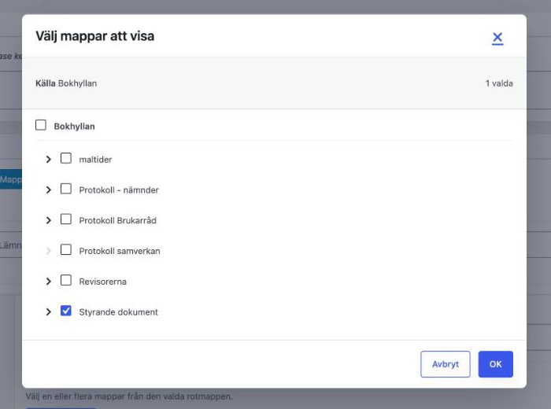
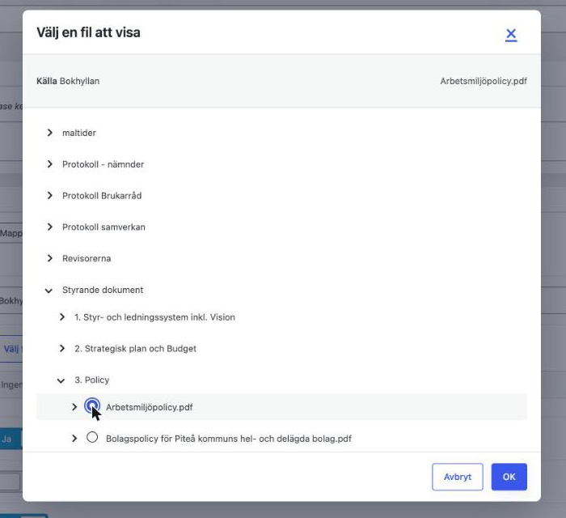
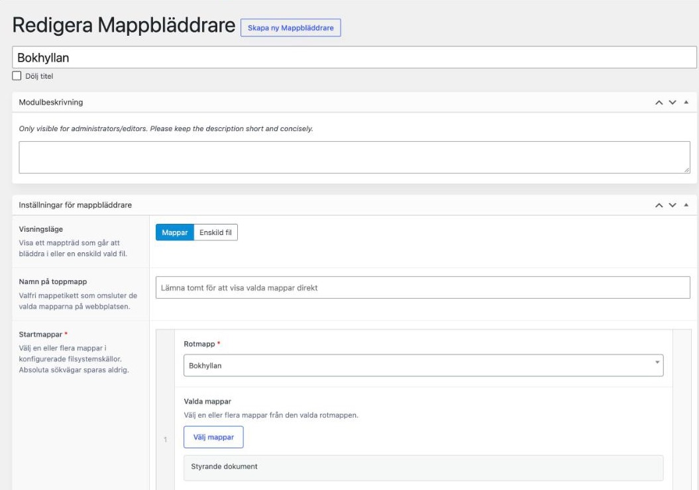
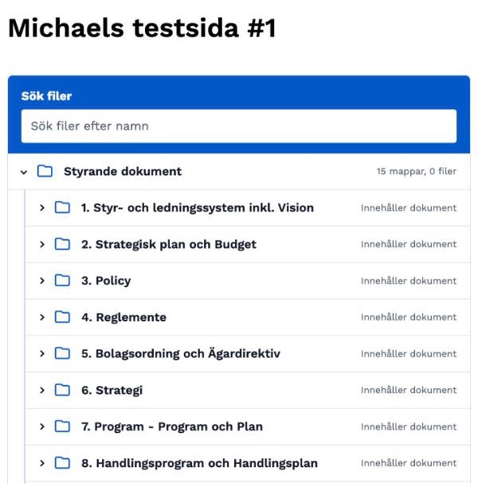
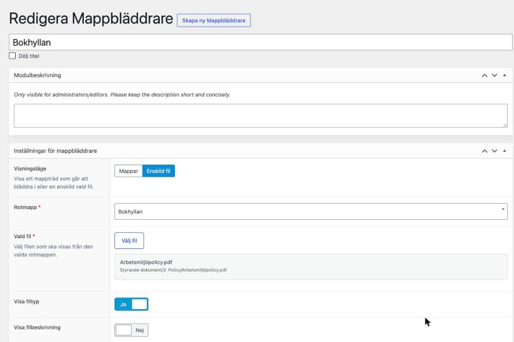

# Lathund: Mappbläddrare

Modulen **Mappbläddrare** visar dokument som ligger i **Bokhyllan**, så att besökare kan bläddra, söka och ladda ned filer direkt på webbplatsen. Du slipper ladda upp varje fil för sig i mediabiblioteket.

> **Obs:** Filerna hanteras i Bokhyllan, inte i WordPress. Lägg alltså in eller byt ut filer i Bokhyllan. De uppdateras sedan automatiskt i modulen (det kan dröja några minuter).

---

## Mappar eller Enskild fil?

Det första du väljer är **Visningsläge**.

| | **Mappar** | **Enskild fil** |
| :--- | :--- | :--- |
| **Visar** | Ett helt mappträd med flera filer från Bokhyllan | En enda fil från Bokhyllan |
| **Besökaren kan** | Fälla ut mappar, söka och ladda ned | Ladda ned just den filen |
| **Passar för** | Protokoll, handlingar, blanketter | En specifik PDF, t.ex. en broschyr eller ett beslut |

> **Tips:** Behöver du bara visa ett dokument? Välj *Enskild fil*. Då kan besökaren inte se eller komma åt övriga filer i samma mapp.

## Visa en mapp

1. Lägg till modulen **Mappbläddrare** på sidan
2. Välj **Mappar** som Visningsläge
3. Under **Startmappar**, välj **Rotmapp** (Bokhyllan) och klicka sedan på **Valda mappar** för att bocka i de mappar som ska visas
4. Skriv ett **Namn på toppmapp** om du vill ha en rubrik som samlar mapparna
5. Kryssa i **Utfälld från början** om mappen ska vara öppen när sidan laddas
6. Aktivera **Aktivera sök** om det är många filer
7. Välj **Sorteringsordning**, t.ex. *Nyast först* för protokoll

## Visa en enskild fil

1. Lägg till modulen **Mappbläddrare** på sidan
2. Välj **Enskild fil** som Visningsläge
3. Välj **Rotmapp** (Bokhyllan) och därefter **Vald fil**

## Visa rätt information

Under inställningarna kan du välja vad som visas bredvid filen:

* **Visa filtyp**, **Visa filstorlek** och **Visa ändringsdatum**
* **Visa filbeskrivning**
* **Nedladdningsvisning**: *Text* eller *Ikon*

## Så väljer du mapp eller fil

När du klickar på **Välj mappar** (steg 3) öppnas en ruta där du bockar i de mappar som ska visas.

När du klickar på **Välj fil** öppnas en ruta där du fäller ut mapparna och markerar en fil.

## Exempel

### Mappar

**Så ställer du in det i admin:**

**Så ser det ut på webbplatsen:**

### Enskild fil

**Så ställer du in det i admin:**

**Så ser det ut på webbplatsen:**

